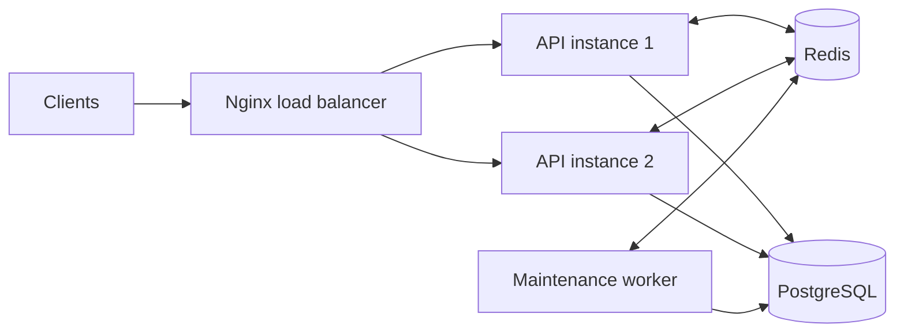

# Realtime Messaging System

[](https://github.com/Amr-Abdelazim/realtime-messaging-system/actions/workflows/ci.yml)

A TypeScript backend MVP for real-time direct and group messaging. It combines
REST and Socket.IO APIs with durable message storage, reconnect synchronization,
online presence, background maintenance, and horizontal API scaling.

> **Project status:** The backend MVP is implemented. The `apps/web` workspace
> is currently a placeholder, not a production-ready web client.

## Capabilities

- **Authentication and profiles:** registration, login, refresh-token rotation,
  logout, profile management, and user search.
- **Direct and group conversations:** create direct chats without duplicates;
  create, rename, and manage group members; list conversations by recent activity.
- **Reliable messaging:** text messages, replies, soft deletion, cursor-paginated
  history, per-conversation sequence numbers, and idempotent send retries.
- **Delivery and read state:** delivered/read sequence watermarks and unread
  counts, with REST and Socket.IO support.
- **Realtime presence:** online/offline updates, last-seen information, and
  typing indicators.
- **Reconnect synchronization:** clients can fill message gaps after disconnects
  and merge retries without duplicate effects.
- **Horizontal scale-out:** multiple API instances share Socket.IO broadcasts,
  room membership, and presence state through Redis.
- **Operations:** health and readiness endpoints, structured logs, Prometheus
  metrics, graceful shutdown, and a background worker for maintenance jobs.

## Architecture



- **PostgreSQL** is the durable source of truth for users, sessions,
  conversations, participants, and messages.
- **Redis** supports cross-instance Socket.IO communication, presence,
  rate-limiting, and BullMQ jobs.
- **The worker** flushes last-seen updates and runs presence sweeps every
  30 seconds, removes expired sessions hourly, and reconciles unread counts
  daily at midnight UTC.
- **The API** persists messages before acknowledging and broadcasting them.
  Per-conversation sequence numbers and client-generated message IDs support
  ordering, gap recovery, and safe retries.

## Technology

| Area                     | Tools                                              |
| ------------------------ | -------------------------------------------------- |
| Runtime and language     | Node.js 22, TypeScript                             |
| HTTP and realtime        | Express 5, Socket.IO                               |
| Persistence              | PostgreSQL, Prisma                                 |
| Shared state and jobs    | Redis, Socket.IO Redis adapter, BullMQ             |
| Validation and contracts | Zod, shared TypeScript contracts                   |
| Authentication           | JWT access tokens, rotating refresh tokens, Argon2 |
| Logging and metrics      | Pino, Prometheus                                   |
| Tests and tooling        | Vitest, Supertest, pnpm workspaces                 |
| Local deployment         | Docker Compose, nginx                              |

## Quick start

### Requirements

- Node.js 22
- pnpm 12.21.0 (the version pinned in `package.json`)
- Docker and Docker Compose

### Run the full stack

```sh
cp .env.example .env
```

Set `JWT_ACCESS_SECRET` in `.env` to a unique random value of at least 32
characters. For example:

```sh
openssl rand -base64 32
```

Then start the stack:

```sh
docker compose up --build
```

Compose starts PostgreSQL and Redis, applies Prisma migrations, starts two API
instances and the maintenance worker, and exposes nginx on
[`http://localhost:8080`](http://localhost:8080).

Check the deployment:

```sh
curl http://localhost:8080/health
curl http://localhost:8080/ready
```

`/health` reports the responding API instance. `/ready` checks whether the
instance can serve traffic. The nginx root path intentionally returns `404`;
the web workspace is not implemented yet.

To stop the stack, press `Ctrl+C` or run `docker compose down`. Persistent
PostgreSQL and Redis data are stored in Compose volumes.

## API overview

The REST API base path is `/api/v1`.

| Method         | Path                                 | Purpose                                                  |
| -------------- | ------------------------------------ | -------------------------------------------------------- |
| `POST`         | `/auth/register`                     | Register and create a session                            |
| `POST`         | `/auth/login`                        | Authenticate and create a session                        |
| `POST`         | `/auth/refresh`                      | Rotate the refresh token                                 |
| `POST`         | `/auth/logout`                       | Revoke the refresh session                               |
| `GET`, `PATCH` | `/users/me`                          | Read or update the authenticated profile                 |
| `GET`          | `/users`                             | Search users by username or display name                 |
| `GET`, `POST`  | `/conversations`                     | List conversations or create a direct/group conversation |
| `GET`          | `/conversations/:id`                 | Get conversation details                                 |
| `PATCH`        | `/conversations/:id`                 | Rename a group                                           |
| `POST`         | `/conversations/:id/members`         | Add group members                                        |
| `DELETE`       | `/conversations/:id/members/:userId` | Remove a group member                                    |
| `POST`         | `/conversations/:id/leave`           | Leave a group                                            |
| `GET`          | `/conversations/:id/messages`        | Load paginated message history                           |
| `POST`         | `/conversations/:id/read`            | Advance the read watermark                               |
| `DELETE`       | `/messages/:id`                      | Soft-delete your own message                             |
| `GET`          | `/presence?ids=...`                  | Query presence for up to 50 users                        |

Protected routes use a bearer access token. Refresh tokens are returned in an
HTTP-only cookie. Request payloads and shared API contracts are validated with
Zod.

### Socket.IO events

Connect to the same origin as the REST API and provide the access token in the
Socket.IO `auth` payload. The client-to-server events are:

`message:send`, `message:delete`, `message:delivered`, `conversation:read`,
`typing:start`, `typing:stop`, and `presence:ping`.

Server events include `ready`, `message:new`, `message:deleted`, `message:status`,
`conversation:created`, `conversation:updated`, `conversation:removed`,
`typing`, `presence:update`, and `rate_limited`. Message operations use
acknowledgements; send requests include a `clientMessageId` so reconnect retries
are idempotent. Clients should send `presence:ping` every 25 seconds; presence
expires after 60 seconds without a heartbeat.

The shared `@realtime-messaging/client-core` package provides a framework-free
`ChatClient`, in-memory storage, reconnect synchronization, and an outbox for
message retries. See [`docs/dev.md`](docs/dev.md) for the socket CLI and client
usage details.

## Development and testing

Install dependencies and generate the Prisma client:

```sh
pnpm install
pnpm exec prisma generate
```

For host-based development, start PostgreSQL and Redis first, ensure the
databases and values in `.env` are available, apply migrations, then start the
API and worker in separate terminals:

```sh
pnpm db:deploy
pnpm --filter @realtime-messaging/api dev
pnpm --filter @realtime-messaging/worker dev
```

Common checks:

```sh
pnpm lint
pnpm typecheck
pnpm build
pnpm test
```

The integration suites require PostgreSQL and Redis. To run the CI-gated
integration tests locally, start the Compose data services, make sure the
`chat_test`, `chat_worker_test`, and `chat_t23_test` databases exist and have
the Prisma migrations applied, then run:

```sh
docker compose up -d postgres redis
CI=true pnpm test
```

The PostgreSQL init script creates the test databases on a fresh volume. The
[CI workflow](.github/workflows/ci.yml) shows how the databases are provisioned
and migrated before the full suite runs.

## Configuration

The example configuration is in [`.env.example`](.env.example). Important
settings:

| Variable                 | Description                                                   |
| ------------------------ | ------------------------------------------------------------- |
| `DATABASE_URL`           | PostgreSQL connection string for the application              |
| `DATABASE_URL_TEST`      | PostgreSQL connection string for API integration tests        |
| `REDIS_URL`              | Redis connection string                                       |
| `JWT_ACCESS_SECRET`      | Secret used to sign access tokens; use at least 32 characters |
| `JWT_ACCESS_TTL_SECONDS` | Access-token lifetime (default: 900 seconds)                  |
| `REFRESH_TTL_DAYS`       | Refresh-session lifetime (default: 30 days)                   |
| `COOKIE_SECURE`          | Set to `true` when serving over HTTPS                         |
| `CORS_ORIGINS`           | Comma-separated list of allowed browser origins               |
| `TRUST_PROXY`            | Number of trusted proxy hops; set appropriately behind nginx  |
| `INSTANCE_ID`            | API instance identifier included in logs and health responses |

Replace the example database credentials and JWT secret before exposing the
stack to an untrusted network.

## Operations

- `GET /health` reports process health and instance identity.
- `GET /ready` reports dependency readiness and returns `503` during shutdown.
- `GET /metrics` exposes Prometheus metrics on each API instance. Nginx
  intentionally returns `404` for this path; scrape the instances internally.
- On `SIGTERM` or `SIGINT`, an API instance withdraws readiness, drains active
  socket work, disconnects its local sockets, and closes its database and Redis
  connections. Shutdown has a 15-second hard timeout.
- See [`docs/scaling.md`](docs/scaling.md) for the deployment topology and
  cross-instance realtime behavior.

## Repository layout

```text
apps/
  api/                 Express, Socket.IO, and API integration tests
  worker/              BullMQ maintenance worker
  web/                 Placeholder workspace
packages/
  client-core/         Framework-free realtime client and outbox
  contracts/           Shared validation schemas and TypeScript contracts
prisma/                Database schema and migrations
infra/                 nginx and PostgreSQL initialization
docs/                  Development and scaling notes
scripts/               Socket.IO CLI for manual testing
```

## MVP scope

The current MVP focuses on text messaging and backend reliability. File and
image attachments, message editing, reactions, push notifications, message
search, voice/video calls, end-to-end encryption, and a production web
application are outside the current scope.
